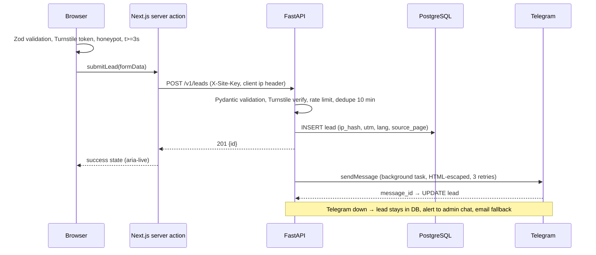

# Architecture — krishki.uz (MVP, launch November 2026)

Status: proposed 2026-10-15, waiting for approval. Scope: MVP from docs/client-brief.md. Phase 2 items are marked.

## 1. System diagram

```mermaid
flowchart LR
  U[Browser<br/>ru / uz / en] -->|HTTPS| C[Caddy<br/>TLS, security headers]
  C --> W[Next.js 15 web<br/>SSG pages + server action]
  C -->|/api/* internal only| A[FastAPI api<br/>/v1/leads, /healthz]
  W -->|server-to-server<br/>X-Site-Key| A
  A --> D[(PostgreSQL 16<br/>leads, lead_events)]
  A -->|Bot API| T[Telegram<br/>sales group → Oleg]
  A -.->|fallback| M[SMTP mailbox<br/>TODO(client)]
  U -->|widget| TS[Cloudflare Turnstile]
  A -->|siteverify| TS
  U -->|after consent| G[GTM → GA4]
  U -->|after consent| Y[Yandex Metrica]
  B[backup container<br/>nightly pg_dump] --> D
  B -->|encrypted| S[(off-site storage)]
```

Hosting: not decided yet (ADR 0004 withdrawn on 2026-10-15). The Docker Compose setup and the Next.js standalone build run on any VPS or on Vercel + VPS.

## 2. Lead form request flow



The client never talks to FastAPI directly, so CORS stays closed and the API key never reaches the browser.

## 3. Rendering strategy per page

| Route (per locale /ru /uz /en) | Strategy | Client islands |
|---|---|---|
| `/` home | SSG | hero sequence (lazy), lead form, lang switch, mobile menu |
| `/products/sko-i82` | SSG | lead form ("Запросить прайс", product preset) |
| `/products/twist-off` | SSG | lead form |
| `/brands` (Мечта хозяйки, Елисейские крышки, Моя мечта, Роса, Гурман if confirmed) | SSG | design grid filter (plain JS, no WebGL) |
| `/about` | SSG | none |
| `/contacts` | SSG | lead form, static map image + link (no map JS on load) |
| `/privacy` | SSG | none |
| `/` (no locale) | middleware redirect by Accept-Language, default ru | — |
| Old URLs `/produkciya/`, `/uslugi/`, `/o-nas/`, `/polezno-znat/` | 301 in next.config redirects | — |
| Phase 2: `/designs/[slug]`, `/services/*`, `/private-label`, country landings, `/admin` | SSG / ISR with revalidateTag | 3D wall, admin UI |

Content in MVP is in the repo: `apps/web/messages/{ru,uz,en}.json` and `apps/web/content/lids.json`. Changing content means a commit and a redeploy (minutes). Admin with live updates is phase 2 (ADR 0005).

## 4. Where heavy assets load
- Hero: static first frame (AVIF/WebP, < 120 KB) is the LCP element, server-rendered `` with `fetchpriority="high"`.
- Short image sequence (≈ 60–90 frames, ADR 0003) loads after `load` + idle, only if `prefers-reduced-motion` is off and the connection is not `saveData`. GSAP + ScrollTrigger + Lenis in one lazy chunk (< 60 KB gz).
- Design grid: responsive `` with width/height, `loading="lazy"`, WebP 400/800.
- three / R3F: not shipped in MVP. Phase 2 wall loads as a dynamic import when the section is near the viewport.

## 5. Repository layout (scaffold after approval)
```
apps/web        Next.js 15, TS strict, Tailwind v4, next-intl
apps/api        FastAPI, SQLAlchemy 2 async, Alembic, aiogram 3
packages/shared openapi.json + generated TS types, shared enums (direction, product)
infra/          docker-compose.yml, Caddyfile, backup script
docs/           architecture, adr, plans, perf, security
qa/             screens, reports
```

## 6. Environments
- local: `docker compose up db api` + `pnpm dev` (web)
- staging: same host as production, `staging.<domain>` or a temporary domain, basic auth, noindex, separate Telegram test group
- production: `krishki.uz` after domain recovery (blocker). Fallback: temporary domain, then 301 to krishki.uz when access returns.

## 7. Risks
| Risk | Effect | Mitigation |
|---|---|---|
| Domain access not recovered by 30 Oct | no launch on krishki.uz | launch on temporary domain, start recovery via cctld.uz now |
| Data localisation law | hosting abroad may be illegal for leads | hosting decision postponed; ask the lawyer before choosing a host |
| No design scans | weak brands/designs page | launch with 7 catalog photos, grid ready for more |
| Late uz/en approval | languages delayed | ru launches first only if Oleg agrees; otherwise translation by 2 Nov |
| Docker/infra on Windows dev machine | slower local backend | testcontainers in CI, API also runnable with uv locally |
